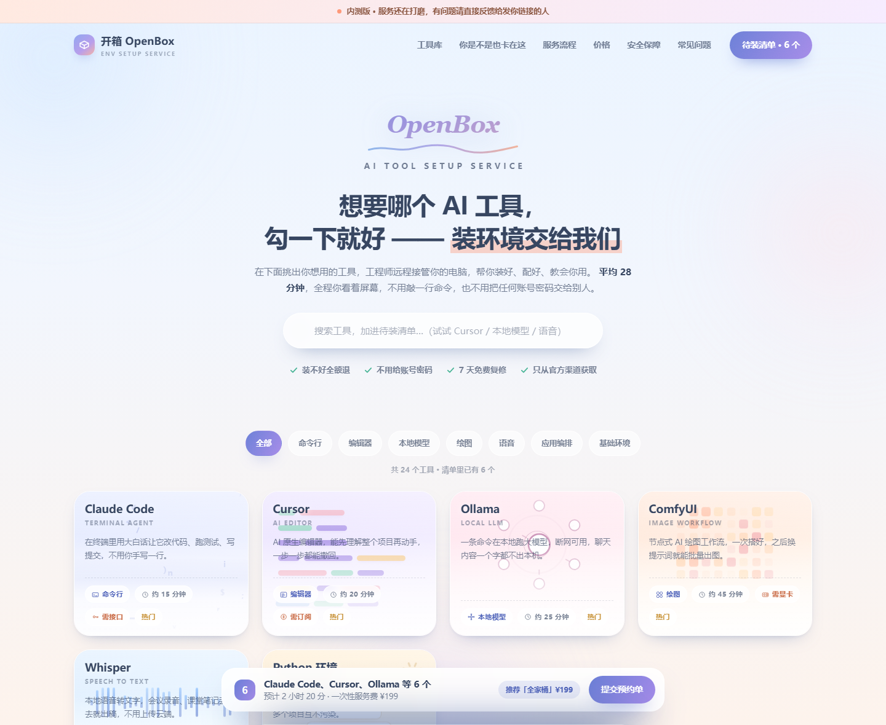
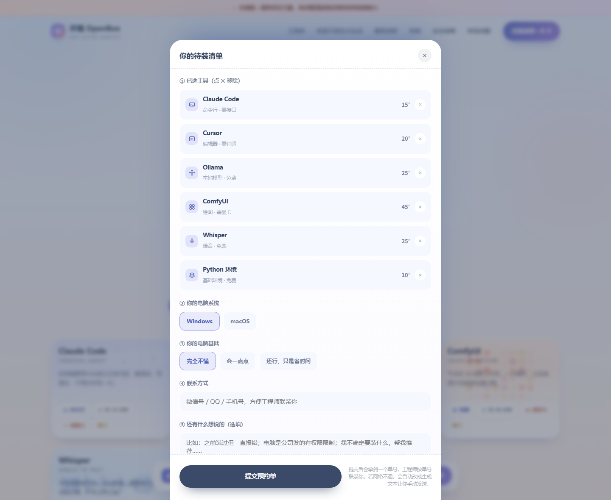
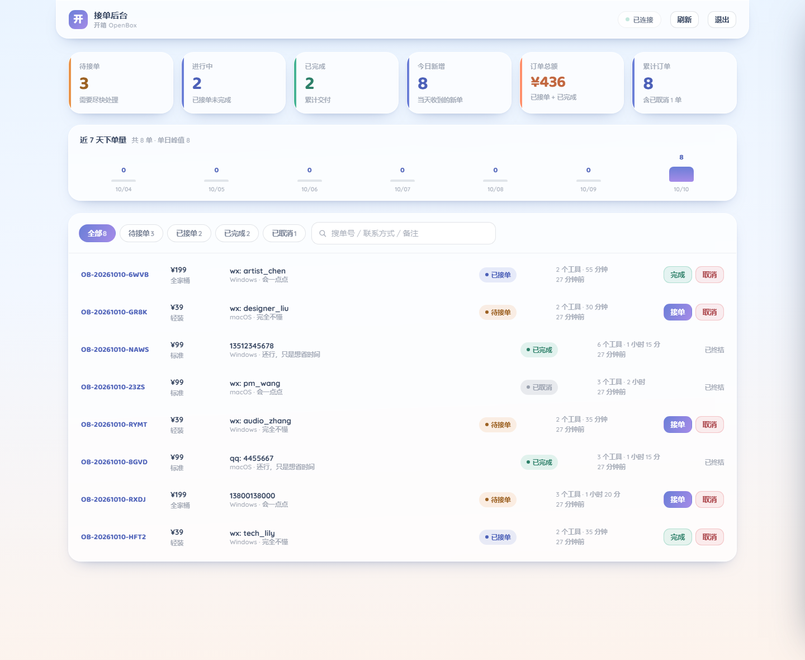
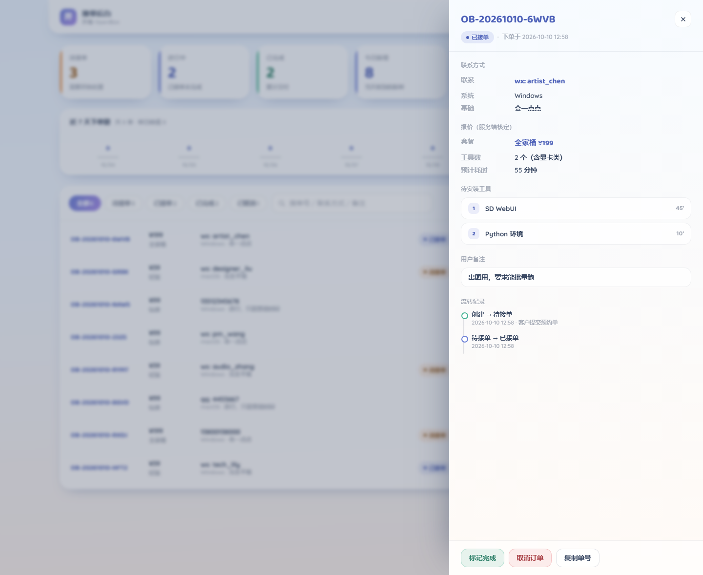

# 开箱 OpenBox · 环境代装服务站

给「想用 AI 工具、但卡在装环境」的普通人提供的远程代装服务站点。
落地页负责收集需求，后端把预约单落库，接单后台让你真正收到订单——而不是让用户手动复制粘贴。

零第三方运行时依赖：数据库用 Node 内置的 `node:sqlite`，不需要 `npm install`。

---

## 快速开始

要求 **Node.js ≥ 22.5**（需要内置的 `node:sqlite`）。

```bash
cd openbox-service
npm start
```

`.env` 已经配好了（含后台口令），开箱可用。启动后会打印地址：

| 地址 | 说明 |
| --- | --- |
| `http://127.0.0.1:8788/` | 落地页（工具卡片库 + 待装清单 + 提交预约单） |
| `http://127.0.0.1:8788/admin.html` | 接单后台（需口令登录） |
| `http://127.0.0.1:8788/health` | 存活探针 |
| `http://127.0.0.1:8788/ready` | 就绪探针（含数据库连通性） |

> 后台地址**有意不在落地页里放任何链接**，并且带了 `noindex`，避免被顺手点开或被搜索引擎收录。
>
> 📖 **自己测 / 拉人内测，看 [docs/自测与内测手册.md](docs/自测与内测手册.md)** —— 里面有逐项自测清单、局域网内测的完整步骤（含防火墙）、常见问题和收反馈要问什么。

### 常用命令

```bash
npm start        # 启动服务
npm test         # 一键回归：接口层 109 项断言（隔离实例 + 临时库，不碰正式数据）
npm run e2e      # 浏览器层自测：无头 Edge 真实点击完整链路，32 项断言（需服务在跑）
npm run seed     # 灌一批演示订单（需服务在跑）
npm run export   # 导出订单 CSV（含 BOM，Excel 直开不乱码）
npm run reset-db # 清空数据库重来
npm run shots    # 重新生成 docs/screenshots 里的预览图（需服务在跑 + 本机有 Edge）
```

### 内测想让别人访问？

改 `.env` 的 `HOST=0.0.0.0` 重启，启动横幅会多打印一行局域网地址，把它发给测试者即可。
⚠️ 只在你自己家的 Wi-Fi 下这么做，公共网络别开。细节见手册第 2 节。

---

## 界面预览

| 落地页 | 待装清单 |
| --- | --- |
|  |  |

| 接单后台 | 订单详情 |
| --- | --- |
|  |  |

---

## 目录结构

```
openbox-service/
├── server.js                    # 启动入口：迁移 → 初始化口令 → 监听 → 优雅停机
├── index.html                   # 落地页（单文件，提交预约单走 /api/orders）
├── admin.html                   # 接单后台（单文件，登录 + 看板 + 列表 + 详情抽屉）
├── .env                         # 本地配置（含后台口令，已被 gitignore）
├── .env.example                 # 全部环境变量说明（只有占位值）
├── docs/
│   ├── 自测与内测手册.md          # ← 自测清单 + 内测流程
│   └── screenshots/             # 界面预览图
├── src/
│   ├── config.js                # 集中配置：类型化读取 + 启动时校验 + 快速失败
│   ├── errors.js                # 类型化错误体系（AppError 及各子类）
│   ├── logger.js                # 结构化 JSON 日志 + 请求上下文 + 敏感字段脱敏
│   ├── db.js                    # 连接管理 + 有序幂等迁移 + 事务封装
│   ├── domain/
│   │   ├── toolCatalog.js       # 服务端权威工具目录（24 个工具 / 7 个分类）
│   │   └── pricing.js           # 定价规则（纯函数，唯一权威）
│   ├── repositories/
│   │   ├── orderRepository.js   # 订单与流转记录的读写
│   │   └── sessionRepository.js # 会话与配置项读写
│   ├── services/
│   │   ├── orderService.js      # 业务规则：校验、单号、状态机、统计
│   │   └── authService.js       # scrypt 口令哈希 + 会话令牌
│   └── http/
│       ├── app.js               # 路由表 + 管线 + 全局错误处理
│       ├── static.js            # 静态文件（默认拒绝 + 显式白名单）
│       └── rateLimit.js         # 滑动窗口限流
├── tests/
│   ├── run-all.js               # 一键测试：起隔离实例 → 跑全部套件 → 清理
│   ├── api.test.js              # 接口契约与业务规则（69 项）
│   ├── admin.test.js            # 后台端到端链路（40 项）
│   └── seed-demo.js             # 演示数据种子
└── scripts/
    ├── export-orders.js         # 导出订单 CSV
    ├── e2e-selftest.js          # 浏览器端到端自测（无头 Edge 真实点击）
    ├── capture-screenshots.js   # 无头浏览器截图
    └── reset-db.js              # 清空数据库（需手动输入 yes）
```

---

## 环境变量

完整清单见 `.env.example`。常用的几个：

| 变量 | 默认值 | 说明 |
| --- | --- | --- |
| `PORT` / `HOST` | `8788` / `127.0.0.1` | 监听地址。绑 `0.0.0.0` 时生产环境强制要求 `ALLOWED_ORIGINS` |
| `NODE_ENV` | `development` | 设为 `production` 会启用严格校验 |
| `ADMIN_PASSWORD` | 空 | **生产必填**（≥10 位）。设置后每次启动都会覆盖数据库里的哈希，环境变量始终是权威 |
| `SESSION_SECRET` | 空 | **生产必填**（≥32 字符） |
| `DATA_DIR` | `./data` | SQLite 文件所在目录 |
| `ORDER_RATE_MAX` | `20` | 同一 IP 在下单窗口内的最大提交次数（**校验失败的提交也计数**，用于防刷） |
| `LOGIN_RATE_MAX` | `10` | 登录尝试上限 |
| `TRUST_PROXY_HOPS` | `0` | 只有确实在反向代理后面才设。非 0 时才信任 `X-Forwarded-For` |
| `BETA_MODE` | `off` | 设 `on` 时落地页顶部显示内测横幅（正式对外前改回 `off`） |
| `BETA_NOTE` | 一段默认文案 | 内测横幅上的文字 |

**没设 `ADMIN_PASSWORD` 时**：首次启动会自动生成一个口令、写入数据库并打印一次；后续启动从数据库读取。想换口令，直接设 `ADMIN_PASSWORD` 重启即可。

---

## 接口

公开：

| 方法 | 路径 | 说明 |
| --- | --- | --- |
| `GET` | `/health` `/ready` | 存活 / 就绪 |
| `GET` | `/api/catalog` | 工具目录与套餐（前端可用来对齐） |
| `GET` | `/api/site-config` | 站点运行时配置（目前只有内测横幅开关，不含任何密钥） |
| `POST` | `/api/orders` | 提交预约单 |

需要 `Authorization: Bearer <token>`：

| 方法 | 路径 | 说明 |
| --- | --- | --- |
| `POST` | `/api/auth/login` | 用口令换令牌 |
| `POST` | `/api/auth/logout` | 注销当前令牌 |
| `GET` | `/api/auth/me` | 校验令牌是否仍有效 |
| `GET` | `/api/orders` | 列表，支持 `status` / `keyword` / `page` / `pageSize` |
| `GET` | `/api/orders/:id` | 详情（含工具明细与流转记录） |
| `PATCH` | `/api/orders/:id` | 改状态：`taken` / `done` / `canceled` |
| `GET` | `/api/stats` | 看板统计 + 近 7 天趋势 |

状态机是单向的，跳步会被拒绝：

```
pending ──▶ taken ──▶ done
   │           │
   └───────────┴──▶ canceled
```

---

## 测试

```bash
npm test
```

会在 **8799 端口** 起一个隔离实例、用 **独立的临时数据库**（`_tmp/testdata`，跑完自动删除），
依次跑完两套用例（**69 + 40 = 109 项断言**）后关闭服务。**不会碰到你正式的 `data/openbox.db`。**

覆盖的关键点：

- **金额不可篡改**：客户端提交 `price: 1` / `plan: 全家桶` 会被服务端按权威目录重算覆盖；
- **状态机**：跳步、重复接单、终态回退一律 `409`；
- **鉴权**：未登录、伪造令牌、登出后的旧令牌一律 `401`；
- **静态白名单**：`server.js`、`package.json`、`data/openbox.db`、`.env`、`scripts/` 全部 `404`；
- **路径穿越**：`..` 与百分号编码穿越均被拒；
- **跨域**：非白名单 `Origin` 返回 `403`；
- **限流**：超限返回 `429` 并带 `Retry-After`。

---

## 安全设计要点

- **定价只在服务端**：落地页只提交「想装什么 + 联系方式」，套餐与金额由 `domain/pricing.js` 重算。
  客户端传来的 `plan` / `price` / `totalMins` 一律忽略，不一致时记 `warn` 日志。
- **默认拒绝的静态服务**：根目录只放行显式白名单里的几个文件，其余仅允许 `assets/` 下的白名单扩展名。
  这一条是防止源码与依赖清单被直接下载的关键，**不要改回「按扩展名放行」**。
- **口令存储**：scrypt（N=16384, r=8, p=1）加随机盐，比较用 `timingSafeEqual`。
- **令牌**：32 字节随机串，数据库只存 SHA-256 哈希，带 TTL 且读取时顺带清理过期会话。
- **日志脱敏**：`contact` / `password` / `token` 等键名在写日志前自动打码。
- **不记录也不索取**：站点不接触用户的账号密码、支付信息与设备权限。

---

## 部署提示

- 建议挂在反向代理（Nginx / Caddy）后面并启用 HTTPS，同时设置 `TRUST_PROXY_HOPS=1`，
  否则限流会把所有请求算作同一个 IP。
- `ALLOWED_ORIGINS` 用逗号分隔，生产环境不要留通配符。
- SQLite 已开 WAL 模式。单机、日订单量几百以内完全够用；要横向扩就得换 PostgreSQL。
- 数据备份直接复制 `data/` 目录（连同 `-wal` / `-shm` 一起），或停了服务再复制单个 `.db`。
